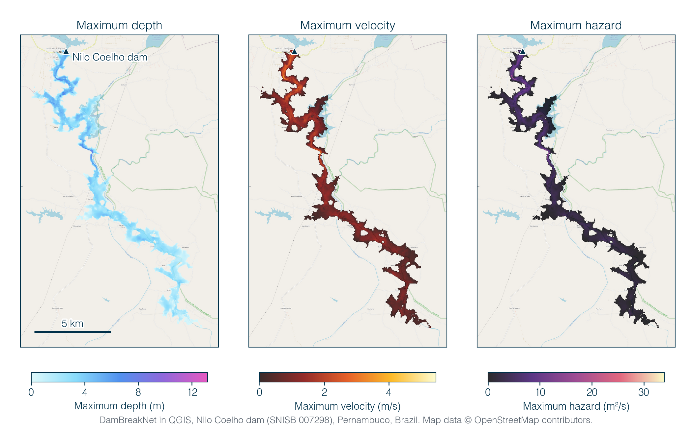
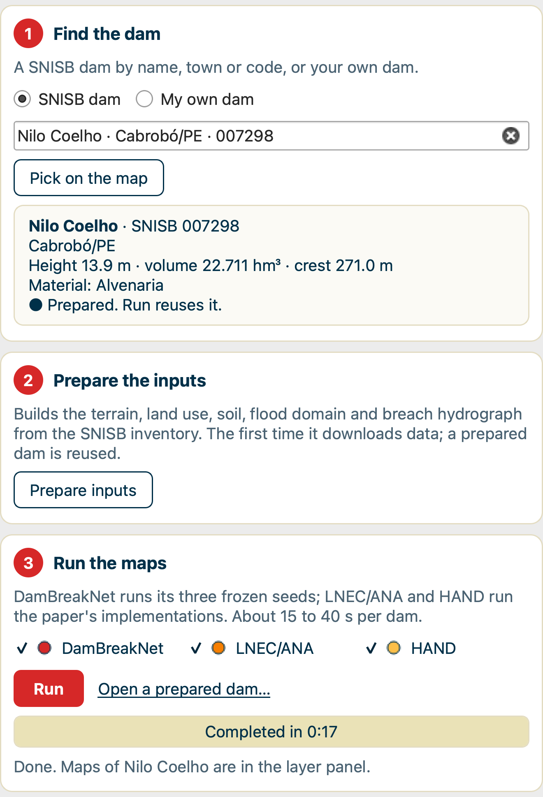

  

<h1 align="center">DamBreakNet for QGIS</h1>

  <b>From a dam on the map to its dam-break flood map, in seconds.</b> 
  A QGIS plugin that maps the maximum flood after a dam break. Trained on dams in Brazil, it also runs on dams elsewhere.

  
  
  
  
  
  
  <!-- ZENODO_BADGE -->

  <a href="#install-in-qgis">Install</a> ·
  <a href="#use-it-in-qgis">Use it</a> ·
  <a href="#what-you-get">What you get</a> ·
  <a href="#how-accurate-is-it">Accuracy</a> ·
  <a href="#questions">Questions</a> ·
  <a href="#how-to-cite">Cite</a>

  

Nilo Coelho dam (SNISB 007298), Cabrobó, Pernambuco. Maximum depth, velocity and hazard
from DamBreakNet over a 78 km² domain on a 30 m grid, shown in QGIS. The three methods ran in
17 seconds on a laptop CPU, and the plugin marked the map as a rapid map. Map data ©
OpenStreetMap contributors.

> This page holds the QGIS plugin, its engine and the three trained models. It does not hold the
> code used to build and train the model.

## What it does

Name a dam, pick it on the map or draw your own. The plugin builds the terrain, land use, soil,
flood domain and breach hydrograph, then maps the maximum flood with a neural network and two
established methods side by side. Everything runs inside QGIS, on your own computer.

| | |
|:---:|---|
| 🧠 | **Three methods, one click.** DamBreakNet (three trained models), LNEC/ANA and HAND run on the same inputs. Maps of the same quantity share one colour scale. |
| 🔎 | **Any SNISB dam, or your own.** Search the 28,083 dams of Brazil's SNISB inventory by name, town or code, or click one on the map. For any other dam, anywhere in the world, draw its crest and type its height, volume and material. |
| 🛰️ | **The data, found for you.** FABDEM terrain, land use (MapBiomas in Brazil, through Google Earth Engine, or ESA WorldCover elsewhere) and OpenLandMap soil classes are downloaded and put on one grid. The flood domain and the breach hydrograph come from the dam's attributes. |
| 🚦 | **A quality check you can act on.** Each map is checked for a flood broken into separate patches and for a wet area far from that of LNEC/ANA. The panel then says *rapid map* or *check with a 2D model*. |
| ⚠️ | **Plain warnings.** The panel says when a dam lies outside the range DamBreakNet learned from, when its land cover is translated from ESA WorldCover, when the preparation flags a domain for review, and why a method could not run. |
| ⏱️ | **Fast.** A prepared dam runs in 15 to 40 seconds on a laptop CPU. A new dam took about 2 minutes in our test, most of it to download the terrain. |

## Install in QGIS

You do this once.

1. **Install QGIS** 3.22 or later from [qgis.org](https://qgis.org). It is free.
2. **Download** `DamBreakNet_v1.0.0.zip` from the [latest release](../../releases/latest).
   Do not unzip it.
3. **Install the plugin.** In QGIS, open **Plugins → Manage and Install Plugins → Install from
   ZIP**, choose the zip and click **Install Plugin**. A red DamBreakNet icon appears in the
   toolbar.
4. **Open the panel.** Click the icon. The panel opens on the right of the map.
5. **Set up the engine.** Click **Set up the engine**, then **Yes**. The plugin downloads the
   methods' own Python (about 1 GB) and builds it. It never touches the
   Python inside QGIS. If the setup stops, click the button again.

To check that it works, type `pirapama` in step 1 of the panel, press Enter and click **Run**.
Pirapama and Nilo Coelho come prepared with the plugin, so they run without any account.

**For any other dam in Brazil**, the land use comes from MapBiomas through Google Earth Engine, which is
free for non-commercial use. Register a project at
[code.earthengine.google.com/register](https://code.earthengine.google.com/register), enter its
ID in the panel's **Settings** tab and click **Sign in to Earth Engine**.

More detail, including your own Python and how to remove the plugin, is in
[INSTALL.md](INSTALL.md).

## Use it in QGIS

The **Run** tab has four numbered steps.

  
  &nbsp;
  

1. **Find the dam.** Type a name, town or SNISB code, and pick a match. Or click **Pick on the
   map** and click a dam (dams ready to prepare are red). The card shows the dam's height, volume,
   crest and material, and whether it is ready. For a dam that is not in SNISB, choose **My own
   dam**, click **Draw the crest**, click along the crest on the map, double-click to finish,
   and type the height, volume and material.
2. **Prepare the inputs.** Click **Prepare inputs**. The progress bar shows each of the seven
   steps, from the terrain download to the breach hydrograph. A prepared dam is kept and reused.
3. **Run the maps.** Leave the three methods ticked and click **Run**. The maps load into the
   Layers panel when the run ends.
4. **Read the results.** The table gives, for each map, the wet area, the number of separate wet
   patches and the share of the wet area connected to the dam, with one value per DamBreakNet
   model. The box below it gives the triage:
   - **Rapid map**: no quality flag, and the DamBreakNet wet area is within 0.7 to 2 times that
     of LNEC/ANA.
   - **Check with a 2D model**: the DamBreakNet map breaks into patches in at least two of its
     three models, or its wet area is far from that of LNEC/ANA. Plan a detailed study for
     this dam.

The **Guide** tab repeats these steps inside QGIS, and the **Log** tab shows the full output of
every step.

## What you get

| Layer group | Layers | Units |
|---|---|---|
| Inputs | DEM, land use, soil, flood domain, inlet and outlet cells | |
| DamBreakNet | maximum depth, maximum velocity, maximum hazard, number of models that flood each cell | m, m/s, m²/s, 0 to 3 |
| LNEC/ANA | maximum depth | m |
| HAND | maximum depth | m |

Every map is a GeoTIFF in the Outputs folder (set in the Settings tab), so you can open it in
any GIS, style it, clip it or overlay it on population and buildings. Hazard is the largest
product of depth and velocity in each cell.

## How accurate is it?

DamBreakNet was trained on two-dimensional HydroPol2D simulations of 382 SNISB dams and tested on
34 dams from river basins it never saw. On those test dams:

| | DamBreakNet | LNEC/ANA | HAND | HydroHP (1D) |
|---|---|---|---|---|
| Flood extent, median critical success index (1 is perfect) | **0.69** | 0.58 | 0.42 | 0.68 |
| Maximum depth, median error | **0.53 m** | 1.09 m | 0.98 m | 0.56 m |
| People exposed, median error | **18%** | 58% | 40% | 23% |
| Dams mapped, of 34 | **34** | 31 | 32 | 25 |
| Median run time per dam | 12 s | 1 s | 3 s | 132 s |

The two-dimensional model took about 2 hours per dam. Each method was scored on the dams it
could map. HydroHP is not in the plugin, because it needs a hydrodynamic run along
cross-sections. Full results are in the paper (see [How to cite](#how-to-cite)).

## Limits

- DamBreakNet was trained and tested on dams in Brazil. Outside Brazil, the plugin translates ESA
  WorldCover land cover to the MapBiomas classes the model reads. Accuracy there is untested, and
  the panel says so.
- DamBreakNet learned from 382 SNISB dams that were 1 to 63.2 m high and held 0.5 to 456 hm³.
  Outside that range its maps are extrapolations, and the panel says so.
- Tailings dams are refused; they need a mudflow model.
- These are rapid maps of the maximum flood for one breach scenario per dam, over the first
  20 km below the dam. They do not give arrival times, and they do not replace a detailed
  two-dimensional study.
- Tested on macOS with QGIS 3.44. Windows and Linux are not tested yet.

## Questions

<b>Does it work outside Brazil?</b>

Yes, with a warning. Choose **My own dam**, draw the crest and type the height, volume and
material. Outside Brazil, the land cover comes from ESA WorldCover, translated to the MapBiomas
classes DamBreakNet was trained on, and no Earth Engine account is needed. On two Brazilian test
dams, translated WorldCover instead of MapBiomas changed the flooded area by 3% or less and did not
change the triage. Accuracy outside Brazil has not been tested.

<b>Does it work in ArcGIS?</b>

The plugin runs in QGIS, which is free. The maps it writes are GeoTIFFs, so you can open them in
ArcGIS or any other GIS.

<b>Do I need a GPU?</b>

No. Everything runs on the CPU of a laptop.

<b>Can I use it for a commercial project?</b>

No. The plugin and the trained models are for non-commercial use. See [LICENSE.md](LICENSE.md).

<b>Does it replace a dam-break study?</b>

No. It gives rapid maps to compare many dams and to decide where a full two-dimensional study is
needed first.

<b>Engine setup failed on Windows with "remove_all: The directory is not empty"?</b>

Install version 1.0.0 and click **Set up the engine** again. Version 0.2.0 built folder paths
longer than the 260 characters Windows allows. Version 1.0.0 keeps them to at most 209. This fix
has not been tested on a Windows computer yet, so please tell us what happens.

<b>Something failed. Where do I look?</b>

The panel's Log tab has the full output of every step. If you report a problem, please paste the
end of the Log tab, your operating system and your QGIS version into a
[new issue](../../issues/new/choose).

## How to cite

If you use DamBreakNet or its maps, please cite the paper:

Gomes Júnior, M. N. (2026). DamBreakNet: A Hydrograph-Conditioned Convolutional Neural Network
for Dam-Break Flood Mapping. Preprint. <!-- ARXIV_LINK -->

To cite this software, use the Zenodo DOI of the release you used. <!-- ZENODO_DOI -->
GitHub's **Cite this repository** button (from [CITATION.cff](CITATION.cff)) gives both.

## Licence

For non-commercial use. The QGIS panel is under GPL-2.0-or-later, the engine under the PolyForm
Noncommercial License 1.0.0, and the trained models under CC BY-NC 4.0, which requires credit to
the author. These licences are proposed and still under review. The data the plugin downloads
keep their own licences, listed in [INSTALL.md](INSTALL.md). See [LICENSE.md](LICENSE.md).

## Contact

Marcus Nóbrega Gomes Júnior, Department of Earth System Science, Stanford University ·
mngomes@stanford.edu · [report a problem](../../issues/new/choose)
