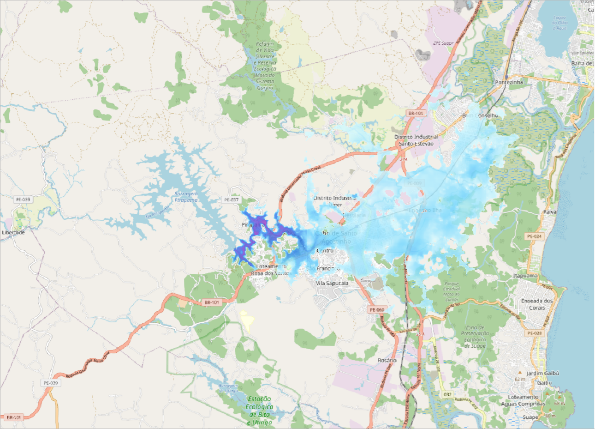
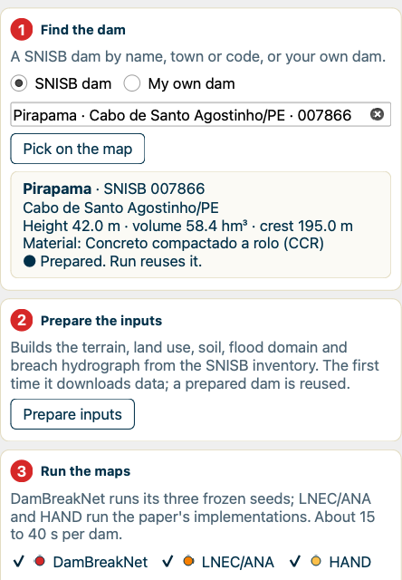
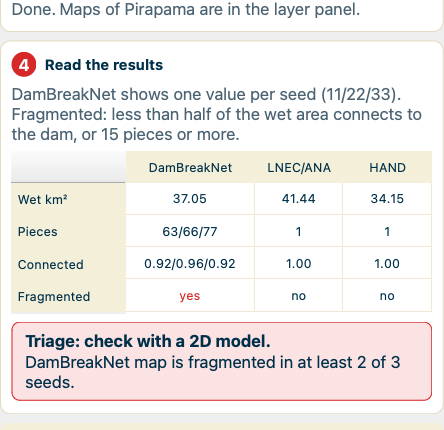
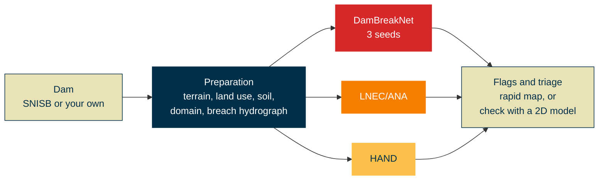

  

<h1 align="center">DamBreakNet for QGIS</h1>

  <b>From a dam on the map to its dam-break flood map, in seconds.</b> 
  A QGIS plugin that maps the maximum flood after a dam break, for dams in Brazil.

  
  
  
  
  
  

<!-- When the repository is public, add live counters next to the badges above:
  
  
  
-->

  <a href="#download">Download</a> ·
  <a href="INSTALL.md">Install</a> ·
  <a href="#how-it-works">How it works</a> ·
  <a href="#questions">Questions</a> ·
  <a href="#how-to-cite">How to cite</a>

Pirapama dam (SNISB 007866), Cabo de Santo Agostinho, Pernambuco. Maximum depth from
DamBreakNet (seed 11) over a 131.7 km² domain on a 30 m grid (146,348 cells). The three
methods ran in about 15 seconds on a laptop CPU. Map data © OpenStreetMap contributors.

> This page holds the QGIS plugin package and the trained weights. It does not hold the code
> used to build and train the model.

## What it does

Name a dam, pick it on the map or draw your own. The plugin builds the terrain, land use, soil,
flood domain and breach hydrograph, then maps the maximum flood with a neural network and two
established methods side by side. Everything runs inside QGIS, on your own computer.

| | |
|:---:|---|
| 🧠 | **Three methods, one click.** DamBreakNet (three trained seeds), LNEC/ANA and HAND run on the same inputs. Maps of the same quantity share one colour scale. |
| 🔎 | **Any SNISB dam, or your own.** Search the 28,083 dams of Brazil's SNISB inventory by name, town or code, or click one on the map. For any other dam, draw its crest and type its height, volume and material. |
| 🛰️ | **The data, found for you.** FABDEM terrain, MapBiomas land use (through Google Earth Engine) and OpenLandMap soil classes are downloaded and put on one grid. The flood domain and the breach hydrograph come from the dam's attributes. |
| 🚦 | **A first quality check.** Each map gets flags for fragmentation and for the share of the wet area connected to the dam. A triage then says *rapid map* or *check with a 2D model*. |
| ⚠️ | **Plain warnings.** The panel says when a dam lies outside the range DamBreakNet learned from, when the preparation flags a domain for review, and why a method could not run. |
| ⏱️ | **Fast.** A prepared dam runs in about 15 seconds on a laptop CPU. A new dam takes 2 to 5 minutes the first time, mostly to download its terrain, and the panel shows each step. |

  
  &nbsp;
  

## How it works

1. **Find the dam.** By name, town or SNISB code, on the map, or by drawing its crest.
2. **Prepare the inputs.** The first time, the plugin downloads the terrain, land use and soil,
   builds the flood domain downstream of the dam and the breach hydrograph. A prepared dam is
   reused.
3. **Run the maps.** DamBreakNet predicts the maximum depth, velocity and hazard. LNEC/ANA and
   HAND give the maximum depth.
4. **Read the results.** The flag table and the triage show which maps look sound and which
   need a 2D model.

## Download

Get the latest version under **[Releases](../../releases)**.

| What | File | Size |
|---|---|---|
| 📦 QGIS plugin, with the trained weights and two prepared demo dams | `DamBreakNet_v0.2.0.zip` | 32 MB |
| 🐍 Python environment for the engine | `environment.yml` (conda) or `requirements.txt` (pip) | small |

### Quick start

1. Create the engine's Python: `conda env create -f environment.yml`.
2. In QGIS: **Plugins → Manage and Install Plugins → Install from ZIP**, then choose the zip.
3. Click the DamBreakNet icon, type `pirapama` and click **Run**.

The full steps, including the Earth Engine sign-in for new dams, are in **[INSTALL.md](INSTALL.md)**.

### Requirements

| | Needed for | Notes |
|---|---|---|
| QGIS 3.22 or later | everything | tested with QGIS 3.44 on macOS |
| A Python with the engine's packages | everything | made from `environment.yml` in about 10 minutes |
| A Google Earth Engine project | new dams | free for non-commercial use; the two demo dams run without it |
| About 500 MB of disk | new dams | the soil file (437 MB, downloaded once) and the terrain of each dam |

## Limits

- Dams in Brazil only, because the land use comes from MapBiomas.
- DamBreakNet learned from 382 SNISB dams that were 1 to 63.2 m high and held 0.5 to 456 hm³.
  Outside that range its maps are extrapolations, and the panel says so.
- These are rapid maps for one breach scenario per dam. They do not replace a 2D hydrodynamic
  study.
- This is a test version. It was checked on macOS; Windows and Linux are not tested yet.

## Questions

<b>Does it work in ArcGIS?</b>

Not yet. The plugin runs in QGIS, which is free. The maps it writes are GeoTIFFs, so you can
open them in ArcGIS or any other GIS.

<b>Do I need a GPU?</b>

No. Everything runs on the CPU of a laptop.

<b>Can I use it for a commercial project?</b>

No. The plugin and the weights are for non-commercial use. See [LICENSE.md](LICENSE.md).

<b>Does it replace a dam-break study?</b>

No. It gives rapid maps to screen dams and to decide where a full 2D study is needed first.

<b>Something failed. Where do I look?</b>

The panel's Log tab has the full output of every step. If you report a problem, please paste
the end of the Log tab into a new issue.

## How to cite

Gomes Júnior, M. N. (2026). DamBreakNet: A Hydrograph-Conditioned Neural Model for Dam-Break
Flood Mapping. Manuscript in review. The full reference will appear here after publication.

GitHub's **Cite this repository** button (from [CITATION.cff](CITATION.cff)) gives the same
reference.

## Licence

For non-commercial use. The QGIS panel is under GPL-2.0-or-later, the engine under the PolyForm
Noncommercial License 1.0.0, and the trained weights under CC BY-NC 4.0. These licences are
proposed and still under review. The data the plugin downloads keep their own licences, listed
in [INSTALL.md](INSTALL.md). See [LICENSE.md](LICENSE.md).

## Contact

Marcus Nóbrega Gomes Júnior, Stanford University · mngomes@stanford.edu ·
[report a problem](../../issues/new/choose)
